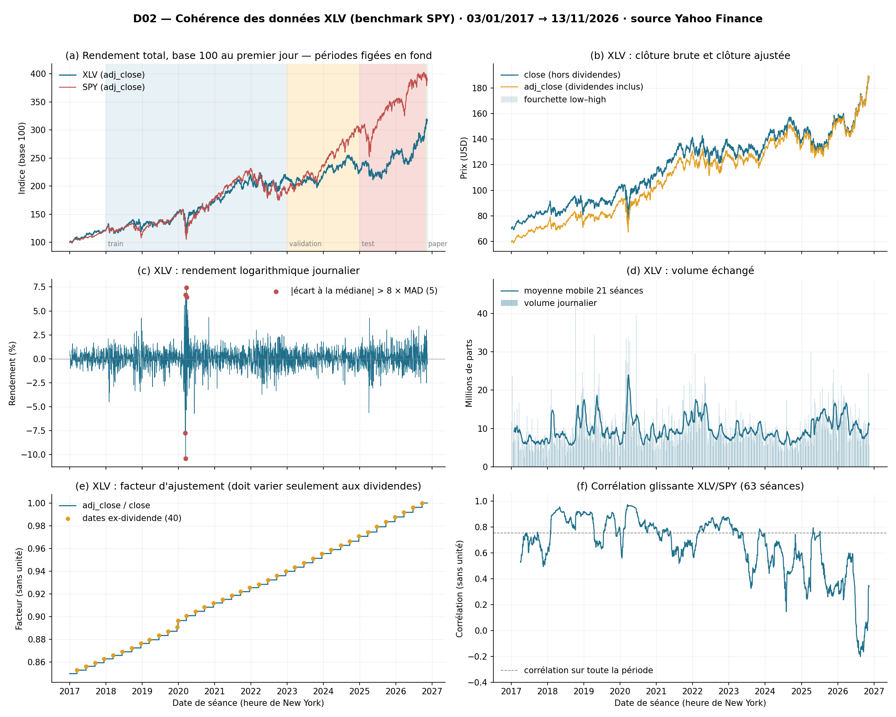

# Données — provenance, schéma et audit (livrable D02)

Binôme **B05 · XLV — Secteur de la santé américain** · benchmark commun **SPY**.

| Pièce demandée (D02) | Où la trouver |
|---|---|
| Script de collecte / mode import | [`src/data.py`](../src/data.py) — `python -m src.data collect` · `load_snapshot()` |
| Snapshot daté | [`data/snapshots/XLV_SPY_1d_20261116.csv`](snapshots/XLV_SPY_1d_20261116.csv) + manifeste `.json` |
| Dictionnaire | ce fichier, section 3 |
| Contrôles qualité | [`src/quality.py`](../src/quality.py) → [`reports/d02_quality_checks.csv`](../reports/d02_quality_checks.csv) et [`reports/d02_data_audit.md`](../reports/d02_data_audit.md) |
| Graphique de cohérence | [`reports/figures/d02_coherence.png`](../reports/figures/d02_coherence.png) |
| Paramètres gelés | [`configs/data.yaml`](../configs/data.yaml) |
| Tests | [`tests/test_data.py`](../tests/test_data.py) — 46 tests, sans réseau |

## 1. Reproduire

```bash
pip install -r requirements.txt

python -m src.data show      # mode DEMO : recharge le snapshot gelé, vérifie son SHA-256 (sans réseau)
python -m src.quality        # relance les 36 contrôles, régénère le rapport et le graphique
python -m pytest             # 46 tests

python -m src.data collect   # (réseau) télécharge à nouveau et gèle un NOUVEAU snapshot daté du jour
```

Depuis le code des autres modules :

```python
from src.data import load_snapshot, get_ticker, log_returns

df = load_snapshot()                 # dernier snapshot gelé, empreinte vérifiée
xlv = get_ticker(df, "XLV")          # indexé par date de séance
r = log_returns(xlv["adj_close"])    # rendement de la séance t, connu après la clôture de t
```

`collect` ne remplace jamais un snapshot existant : chaque photographie reste intacte et
l'application lit toujours un fichier local. Le travail ne dépend donc d'aucune requête future.

## 2. Provenance

| Élément | Valeur |
|---|---|
| Source | Yahoo Finance, API publique non officielle, via la bibliothèque `yfinance` 1.2.0 |
| Appel | `yfinance.Ticker(t).history(start, end, interval="1d", auto_adjust=False, actions=True, repair=False)` |
| Instruments | **XLV** — Health Care Select Sector SPDR Fund (NYSE Arca) ; **SPY** — SPDR S&P 500 ETF Trust (NYSE Arca) |
| Devise | USD |
| Fréquence | journalière : une ligne = une séance régulière |
| Fuseau | `America/New_York` ; `date` est la date de séance, clôture à 16 h 00 heure locale |
| Période demandée | à partir du 2017-01-03, jusqu'à la dernière séance clôturée |
| Période obtenue | 2017-01-03 → 2026-11-13, soit 2 481 séances par ticker (4 962 lignes) |
| Date d'acquisition | 2026-11-16 01:41:44 UTC (dimanche soir à New York : dernière séance = vendredi 13/11) |
| Empreinte SHA-256 | `d80d6249f3dcebd09c6921b8cd0a8f45babbc02b48f1d6fd3a55666b108f69d3` |
| Lacunes | aucune : les 2 481 séances attendues du calendrier NYSE sont présentes |

Ces informations sont aussi enregistrées, de façon lisible par machine, dans le manifeste
`XLV_SPY_1d_20261116.json` placé à côté du CSV.

**Conditions d'utilisation.** Yahoo Finance n'offre ni garantie ni API officielle ; `yfinance` est un
outil indépendant destiné à un usage personnel, de recherche et d'enseignement. Les données ne sont
pas redistribuées en dehors de ce dépôt pédagogique. Aucune clé API n'est nécessaire.

## 3. Dictionnaire des données

Fichier CSV, encodage UTF-8, séparateur `,`, point décimal, 6 décimales, format long
(une ligne par couple `date` × `ticker`), trié par `ticker` puis `date`.

| Colonne | Type | Unité | Définition | Observable à partir de |
|---|---|---|---|---|
| `date` | date `AAAA-MM-JJ` | — | Date de la séance, heure de New York | — |
| `ticker` | texte | — | `XLV` ou `SPY` | — |
| `open` | réel | USD / part | Premier cours de la séance régulière (9 h 30) | ouverture de `t` |
| `high` | réel | USD / part | Cours le plus haut de la séance | clôture de `t` |
| `low` | réel | USD / part | Cours le plus bas de la séance | clôture de `t` |
| `close` | réel | USD / part | Cours de clôture (16 h 00) ; ajusté des fractionnements, **pas** des dividendes | clôture de `t` |
| `adj_close` | réel | USD / part | Clôture ajustée des fractionnements **et** des dividendes | clôture de `t` (voir avertissement) |
| `volume` | entier | parts | Nombre de parts échangées pendant la séance | clôture de `t` |
| `dividends` | réel | USD / part | Dividende détaché ce jour-là (date ex-dividende), 0 sinon | clôture de `t` |
| `stock_splits` | réel | ratio | Ratio de fractionnement ce jour-là, 0 sinon | clôture de `t` |

### Convention d'ajustement

- `open`, `high`, `low`, `close` sont les prix **réellement traités** (aucun fractionnement sur la
  période pour XLV ni pour SPY). Ce sont eux qui servent à **simuler l'exécution** des ordres :
  on achète à l'`open` de `t+1`, pas à un prix reconstruit.
- `adj_close` sert à **calculer les rendements** : il réincorpore les dividendes, donc
  `adj_close_t / adj_close_{t-1} − 1` est le rendement total de la séance.
- Yahoo ajuste **rétroactivement** : à chaque nouveau dividende, tout l'historique de `adj_close`
  est multiplié par un facteur inférieur à 1. Le facteur `adj_close / close` vaut donc 1 sur les
  séances les plus récentes et 0,8496 au 3 janvier 2017 pour XLV.

> **Avertissement anti-fuite.** Le *niveau* de `adj_close` contient les dividendes futurs : il ne doit
> jamais être utilisé comme variable explicative. Les *rendements* calculés sur `adj_close` sont en
> revanche identiques, à la date `t`, quel que soit le moment du téléchargement (le facteur
> multiplicatif se simplifie dans le ratio) : ils sont donc utilisables sans fuite. C'est aussi pour
> cela que le snapshot est gelé : un téléchargement ultérieur donnera d'autres niveaux de `adj_close`.

### Définitions retenues pour la suite du projet

| Notion | Définition |
|---|---|
| Rendement d'une séance | logarithmique : `r_t = ln(adj_close_t / adj_close_{t-1})` (`src.data.log_returns`) |
| Rendement simple (backtest) | `R_t = P_t / P_{t-1} − 1` (`src.data.simple_returns`) |
| Cible de prévision | `r_{t+1}`, rendement de la séance suivante — horizon : une séance |
| Instant d'information | toute variable datée `t` est connue **après la clôture de `t`** (16 h 00 NY) |
| Décision et exécution | signal décidé après la clôture de `t`, ordre exécuté à l'`open` de `t+1` |

## 4. Périodes figées

Fixées dans `configs/data.yaml` **avant tout entraînement** (proposition commune du cahier, section 3).

| Période | Du | Au | Séances | Rôle |
|---|---|---|---|---|
| `warmup` | 2017-01-03 | 2017-12-29 | 251 | amorce les variables retardées et les fenêtres glissantes ; jamais évaluée |
| `train` | 2018-01-02 | 2022-12-30 | 1 259 | apprentissage |
| `validation` | 2023-01-03 | 2024-12-31 | 502 | choix des modèles et des hyperparamètres |
| `test` | 2025-01-02 | 2026-10-30 | 459 | évaluation finale, consultée une seule fois |
| `paper` | 2026-11-02 | (ouverte) | 10 dans ce snapshot | séances postérieures au test, pour le paper trading (D08) |

L'année 2017 a été ajoutée pour qu'une moyenne mobile de 200 séances, par exemple, soit déjà définie
au premier jour de l'apprentissage sans réduire la période `train`.

## 5. Contrôles qualité

`python -m src.quality` exécute 36 contrôles. Statuts : `OK`, `INFO` (fait notable légitime),
`WARN` (anomalie mineure à documenter), `FAIL` (bloquant ; la commande sort alors en erreur).

| Contrôle | Ce qui est vérifié | Statut si violé |
|---|---|---|
| `schema` | les 10 colonnes attendues sont présentes | FAIL |
| `dates_dupliquees`, `dates_triees` | une seule ligne par séance, ordre chronologique | FAIL |
| `valeurs_manquantes` | aucun prix ni volume manquant | FAIL |
| `prix_positifs` | tous les prix > 0 | FAIL |
| `coherence_ohlc` | `low ≤ open, close ≤ high` | FAIL |
| `volume` | volume > 0 (négatif : FAIL ; nul : WARN) | FAIL / WARN |
| `seances_manquantes`, `seances_inattendues` | égalité exacte avec le calendrier NYSE reconstruit indépendamment de la source (jours fériés + fermetures du 05/12/2018 et du 09/01/2025) | FAIL |
| `clotures_figees` | pas de clôture répétée plus de 2 séances de suite | WARN |
| `rendements_extremes` | rendements à plus de 8 × MAD de la médiane, listés pour vérification | INFO |
| `fractionnements` | fractionnements listés | INFO |
| `ajustement_borne` | `adj_close ≤ close` | FAIL |
| `ajustement_hors_dividende` | le facteur `adj_close / close` ne bouge qu'aux dates ex-dividende | FAIL |
| `dividendes_coherents` | chaque dividende déclaré est retrouvé, à 5 % près, dans le saut du facteur d'ajustement | WARN |
| `synchronisation` | XLV et SPY ont exactement les mêmes séances | FAIL |
| `couverture_*` | chaque période figée est complète | FAIL |
| `correlation_benchmark` | corrélation XLV/SPY plausible (> 0,3) | WARN |

### Résultat sur le snapshot du 16/11/2026

**33 OK · 3 INFO · 0 WARN · 0 FAIL — données utilisables.**

Faits notables identifiés :

- **Rendements extrêmes de XLV (5 séances)** : 12/03/2020 (−7,76 %), 13/03/2020 (+6,71 %),
  16/03/2020 (−10,38 %), 24/03/2020 (+7,42 %), 26/03/2020 (+6,43 %). Ils correspondent tous au krach
  du Covid-19 ; quatre des cinq sont aussi signalées sur SPY, et la cinquième (26/03) est une séance
  de fort rebond général : ce sont de vrais mouvements de marché, pas des erreurs de données. Ils sont **conservés** ; les modèles de risque (D04) devront les absorber.
- **Rendements extrêmes de SPY (9 séances)** : cinq journées de mars 2020 (09, 12, 13, 16, 24),
  puis 06/04/2020, 11/06/2020, et les 04/04/2025 (−6,03 %) et 09/04/2025 (+9,99 %), liées aux annonces de droits de
  douane américains. XLV n'est pas signalé à ces deux dernières dates, ce qui est cohérent avec son
  caractère défensif.
- **Dividendes** : 40 détachements trimestriels pour XLV, 39 pour SPY, tous retrouvés dans
  `adj_close` avec un écart maximal de 0,02 %.
- **Corrélation XLV/SPY** des rendements journaliers : 0,752 sur l'ensemble, mais elle chute nettement
  en 2025-2026 (panneau f du graphique). C'est une propriété du marché, pas un défaut de données ;
  elle est à garder en tête pour le SARIMAX avec SPY retardé (D03).

Le détail ligne à ligne et les statistiques descriptives par période sont dans
[`reports/d02_data_audit.md`](../reports/d02_data_audit.md).



## 6. Limites connues

- Yahoo Finance est une source gratuite sans garantie contractuelle ; les valeurs n'ont pas été
  recoupées avec une seconde source. Les contrôles ci-dessus vérifient la cohérence interne et
  calendaire, pas l'exactitude au centime de chaque cours.
- Les séances écourtées (veille de Noël, lendemain de Thanksgiving…) apparaissent comme des séances
  normales, avec un volume plus faible.
- Les prix `open` de Yahoo proviennent d'un flux consolidé et peuvent différer légèrement du cours
  d'enchère d'ouverture officiel ; le glissement de 0,05 % par transaction prévu au backtest couvre
  cette incertitude.
- Le calendrier NYSE de `src/quality.py` est validé sur 2017-2026 ; une fermeture exceptionnelle
  future devra être ajoutée à `NYSE_SPECIAL_CLOSURES`.
