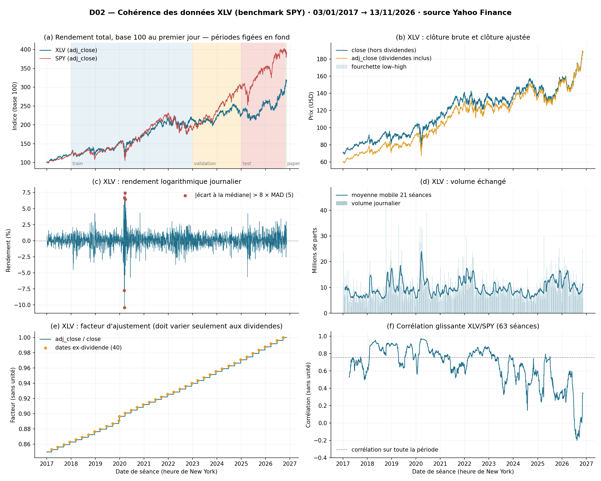

# D02 — Rapport d'audit des données (XLV / SPY)

> Fichier généré par `python -m src.quality`. Ne pas modifier à la main : relancer la commande.

## 1. Snapshot audité

- Fichier : `data/snapshots/XLV_SPY_1d_20261116.csv`
- Empreinte SHA-256 : `d80d6249f3dcebd09c6921b8cd0a8f45babbc02b48f1d6fd3a55666b108f69d3`
- Date d'acquisition : 2026-11-16T01:41:44Z (UTC)
- Source : Yahoo Finance (API publique non officielle) via yfinance 1.2.0
- Lignes : 4962

| ticker | rows | first_date | last_date | n_dividends | n_splits |
|---|---|---|---|---|---|
| SPY | 2481 | 2017-01-03 | 2026-11-13 | 39 | 0 |
| XLV | 2481 | 2017-01-03 | 2026-11-13 | 40 | 0 |

## 2. Verdict

**Données utilisables** : aucun contrôle bloquant.

36 contrôles : 33 OK · 3 INFO · 0 WARN · 0 FAIL.

## 3. Anomalies et faits notables identifiés

| controle | ticker | statut | n | detail |
|---|---|---|---|---|
| rendements_extremes | XLV | INFO | 5 | 2020-03-12 (-7.76%); 2020-03-13 (+6.71%); 2020-03-16 (-10.38%); 2020-03-24 (+7.42%); 2020-03-26 (+6.43%) |
| rendements_extremes | SPY | INFO | 9 | 2020-03-09 (-8.13%); 2020-03-12 (-10.06%); 2020-03-13 (+8.20%); 2020-03-16 (-11.59%); 2020-03-24 (+8.67%); 2020-04-06 (+6.50%); 2020-06-11 (-5.94%); 2025-04-04 (-6.03%); 2025-04-09 (+9.99%) |
| couverture_paper | XLV | INFO | 10 | 10 séances depuis le 2026-10-31 (période ouverte) |

## 4. Détail de tous les contrôles

| controle | ticker | statut | n | detail |
|---|---|---|---|---|
| schema | * | OK | 0 | 10 colonnes attendues présentes |
| dates_dupliquees | XLV | OK | 0 | aucun doublon |
| dates_triees | XLV | OK | 0 | ordre chronologique strict |
| valeurs_manquantes | XLV | OK | 0 | aucune valeur manquante |
| prix_positifs | XLV | OK | 0 | tous les prix > 0 |
| coherence_ohlc | XLV | OK | 0 | low ≤ open, close ≤ high partout |
| volume | XLV | OK | 0 | volume > 0 à chaque séance |
| seances_manquantes | XLV | OK | 0 | 2481 séances NYSE attendues, toutes présentes |
| seances_inattendues | XLV | OK | 0 | aucune ligne un week-end ou jour férié |
| clotures_figees | XLV | OK | 0 | aucune clôture répétée plus de 2 fois de suite |
| rendements_extremes | XLV | INFO | 5 | 2020-03-12 (-7.76%); 2020-03-13 (+6.71%); 2020-03-16 (-10.38%); 2020-03-24 (+7.42%); 2020-03-26 (+6.43%) |
| fractionnements | XLV | OK | 0 | aucun fractionnement sur la période |
| ajustement_borne | XLV | OK | 0 | adj_close ≤ close partout ; facteur de 0.8496 à 1.0000 |
| ajustement_hors_dividende | XLV | OK | 0 | facteur d'ajustement constant hors dates ex-dividende |
| dividendes_coherents | XLV | OK | 0 | 40 dividendes, tous retrouvés dans adj_close (écart max 0.02%) |
| dates_dupliquees | SPY | OK | 0 | aucun doublon |
| dates_triees | SPY | OK | 0 | ordre chronologique strict |
| valeurs_manquantes | SPY | OK | 0 | aucune valeur manquante |
| prix_positifs | SPY | OK | 0 | tous les prix > 0 |
| coherence_ohlc | SPY | OK | 0 | low ≤ open, close ≤ high partout |
| volume | SPY | OK | 0 | volume > 0 à chaque séance |
| seances_manquantes | SPY | OK | 0 | 2481 séances NYSE attendues, toutes présentes |
| seances_inattendues | SPY | OK | 0 | aucune ligne un week-end ou jour férié |
| clotures_figees | SPY | OK | 0 | aucune clôture répétée plus de 2 fois de suite |
| rendements_extremes | SPY | INFO | 9 | 2020-03-09 (-8.13%); 2020-03-12 (-10.06%); 2020-03-13 (+8.20%); 2020-03-16 (-11.59%); 2020-03-24 (+8.67%); 2020-04-06 (+6.50%); 2020-06-11 (-5.94%); 2025-04-04 (-6.03%); 2025-04-09 (+9.99%) |
| fractionnements | SPY | OK | 0 | aucun fractionnement sur la période |
| ajustement_borne | SPY | OK | 0 | adj_close ≤ close partout ; facteur de 0.8590 à 1.0000 |
| ajustement_hors_dividende | SPY | OK | 0 | facteur d'ajustement constant hors dates ex-dividende |
| dividendes_coherents | SPY | OK | 0 | 39 dividendes, tous retrouvés dans adj_close (écart max 0.01%) |
| synchronisation | XLV/SPY | OK | 0 | 2481 séances strictement communes |
| couverture_warmup | XLV | OK | 0 | 251 séances, du 2017-01-03 au 2017-12-29 |
| couverture_train | XLV | OK | 0 | 1259 séances, du 2018-01-02 au 2022-12-30 |
| couverture_validation | XLV | OK | 0 | 502 séances, du 2023-01-03 au 2024-12-31 |
| couverture_test | XLV | OK | 0 | 459 séances, du 2025-01-02 au 2026-10-30 |
| couverture_paper | XLV | INFO | 10 | 10 séances depuis le 2026-10-31 (période ouverte) |
| correlation_benchmark | XLV/SPY | OK | 0 | corrélation des rendements journaliers = 0.752 |

## 5. Statistiques descriptives des rendements

Rendement logarithmique journalier calculé sur `adj_close` (dividendes inclus).

| ticker | periode | seances | moyenne_% | ecart_type_% | min_% | max_% | asymetrie | kurtosis_exces | vol_annualisee_% |
|---|---|---|---|---|---|---|---|---|---|
| XLV | warmup | 250 | 0.074 | 0.545 | -1.32 | 1.69 | 0.02 | 0.24 | 8.7 |
| XLV | train | 1259 | 0.046 | 1.233 | -10.38 | 7.42 | -0.45 | 9.43 | 19.6 |
| XLV | validation | 502 | 0.009 | 0.708 | -2.71 | 2.19 | -0.25 | 0.39 | 11.2 |
| XLV | test | 459 | 0.071 | 1.076 | -5.64 | 4.25 | -0.07 | 2.18 | 17.1 |
| XLV | paper | 10 | 0.213 | 1.473 | -2.54 | 3.02 | 0.23 | 1.58 | 23.4 |
| XLV | ensemble | 2480 | 0.047 | 1.061 | -10.38 | 7.42 | -0.38 | 9.71 | 16.8 |
| SPY | warmup | 250 | 0.076 | 0.424 | -1.79 | 1.39 | -0.45 | 2.88 | 6.7 |
| SPY | train | 1259 | 0.035 | 1.363 | -11.59 | 8.67 | -0.78 | 11.24 | 21.6 |
| SPY | validation | 502 | 0.091 | 0.807 | -3.03 | 2.46 | -0.29 | 0.77 | 12.8 |
| SPY | test | 459 | 0.060 | 1.053 | -6.03 | 9.99 | 0.92 | 20.65 | 16.7 |
| SPY | paper | 10 | -0.018 | 1.856 | -4.51 | 2.34 | -1.54 | 3.91 | 29.5 |
| SPY | ensemble | 2480 | 0.055 | 1.145 | -11.59 | 9.99 | -0.60 | 14.95 | 18.2 |

## 6. Graphique de cohérence

