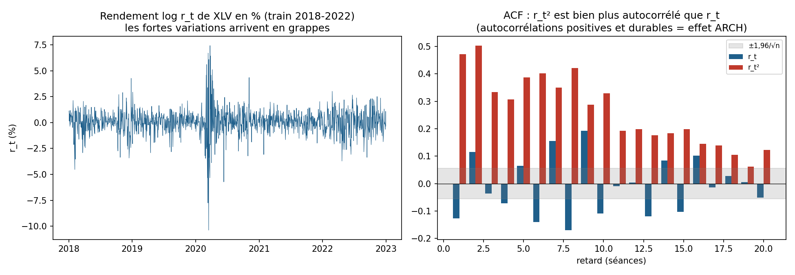
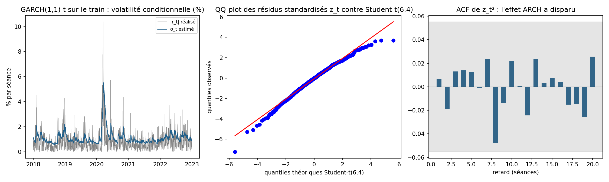
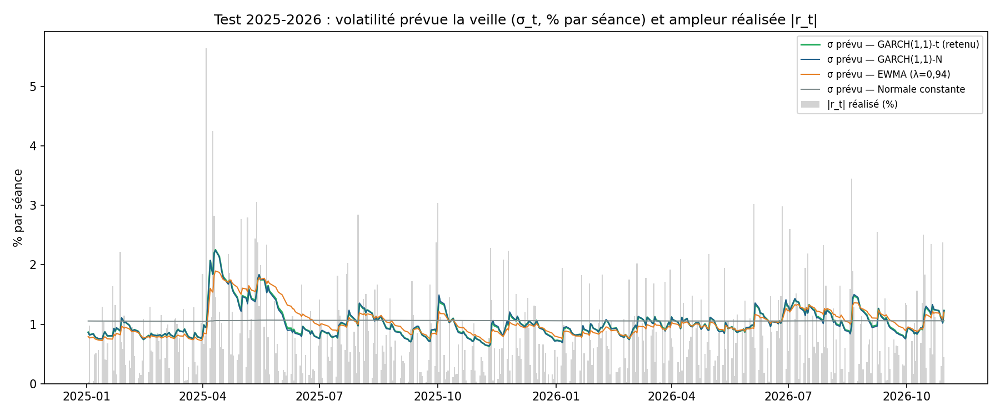
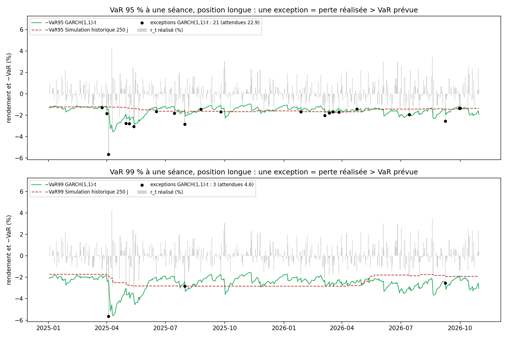
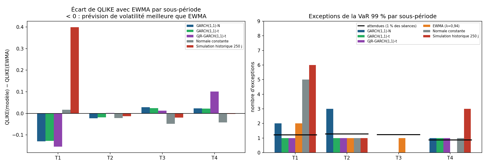

# D04 — Module de risque : volatilité conditionnelle, VaR et ES (XLV)

> Fichier généré par `python -m src.risk_management`. Ne pas modifier à la main : relancer la commande.

## 1. Cadre et unités

- Snapshot figé : `data/snapshots/XLV_SPY_1d_20261116.csv` (SHA-256 `d80d6249f3dcebd0…`, vérifié au chargement). C'est le même que pour D02 et D03 ; il est fixé dans `configs/risk.yaml`, donc un snapshot plus récent ne change pas les résultats.
- Variable : rendement log de XLV **en %**, r_t = 100 · ln(P_t / P_{t-1}), P = prix ajusté.
- Prévision : à la clôture de t-1, on prévoit la **distribution** de r_t : moyenne μ_t, volatilité σ_t (en % par séance ; × √252 pour l'annualiser), puis la VaR et l'ES.
- **VaR** (position longue) : nombre positif, en % de la valeur de la position, tel que P(perte > VaR) = 1 − niveau, avec perte = −r_t. **ES** : perte moyenne au-delà de la VaR (ES ≥ VaR).
- Conversion en dollars sur le capital du cahier (100 000 USD investis) : VaR_USD = C · (1 − exp(−VaR/100)).
- Une **exception** se produit à la séance t si la perte réalisée −r_t dépasse la VaR prévue la veille. Les prévisions sont donc toujours **comparées à des observations futures**.
- Échantillons : train 2018-01-02 → 2022-12-30 (1259 séances) · validation (502) · test 2025-01-02 → 2026-10-30 (459). L'année 2017 amorce seulement EWMA et la simulation historique.
- Walk-forward : fenêtre croissante depuis 2018, paramètres ré-estimés toutes les 21 séances, variance conditionnelle mise à jour chaque jour. Le test `test_garch_walk_forward_no_lookahead` vérifie qu'aucune donnée future n'est utilisée.

## 2. Effet ARCH (train 2018-2022)

| serie | test | statistique | p_value | h0 | verdict |
|---|---|---|---|---|---|
| rendement centré r_t − r̄ | ARCH-LM (5 retards) | 454.7504 | 0.0000 | pas d'effet ARCH | effet ARCH (H0 rejetée) |
| rendement centré r_t − r̄ | ARCH-LM (10 retards) | 499.6100 | 0.0000 | pas d'effet ARCH | effet ARCH (H0 rejetée) |
| rendement centré r_t − r̄ | Ljung-Box sur le carré (10 retards) | 1868.8258 | 0.0000 | pas d'effet ARCH | effet ARCH (H0 rejetée) |
| résidus ARIMA(3,0,2) (D03) | ARCH-LM (5 retards) | 369.9787 | 0.0000 | pas d'effet ARCH | effet ARCH (H0 rejetée) |
| résidus ARIMA(3,0,2) (D03) | ARCH-LM (10 retards) | 398.2454 | 0.0000 | pas d'effet ARCH | effet ARCH (H0 rejetée) |
| résidus ARIMA(3,0,2) (D03) | Ljung-Box sur le carré (10 retards) | 1594.9642 | 0.0000 | pas d'effet ARCH | effet ARCH (H0 rejetée) |

6 tests sur 6 rejettent l'absence d'effet ARCH, y compris sur les résidus de l'ARIMA(3,0,2) retenu en D03. La variance de r_t n'est pas constante : les fortes variations arrivent en grappes. Modéliser la variance conditionnelle est donc justifié.

## 3. Modèles GARCH estimés sur le train

Modèle : r_t = μ + ε_t, ε_t = σ_t z_t, σ²_t = ω + α ε²_{t-1} + γ ε²_{t-1}·1{ε_{t-1}<0} + β σ²_{t-1}. La moyenne est constante, car D03 a montré que la dynamique ARMA n'améliore pas la prévision.

| modele | mu_% | omega | alpha | gamma | beta | nu | persistance | demi_vie_seances | vol_incond_annuelle_% | logvraisemblance | AIC | BIC | ARCH_LM_z_p | LB_z2_p | admissible | motif |
|---|---|---|---|---|---|---|---|---|---|---|---|---|---|---|---|---|
| GARCH(1,1)-N | 0.0804 | 0.0584 | 0.1316 | — | 0.8220 | — | 0.9537 | 14.6082 | 17.8204 | -1805.4118 | 3618.8235 | 3639.3758 | 0.9481 | 0.8461 | True | — |
| GARCH(1,1)-t | 0.0973 | 0.0407 | 0.1277 | — | 0.8444 | 6.4290 | 0.9722 | 24.5522 | 19.1890 | -1775.4039 | 3560.8077 | 3586.4981 | 0.9488 | 0.8487 | True | — |
| GJR-GARCH(1,1)-t | 0.0754 | 0.0355 | 0.0127 | 0.1556 | 0.8758 | 6.8955 | 0.9663 | 20.2484 | 16.2938 | -1766.4167 | 3544.8335 | 3575.6619 | 0.9929 | 0.9274 | True | — |

- persistance = α + β + γ/2 ; demi-vie = nombre de séances pour qu'un choc de volatilité diminue de moitié.
- ARCH_LM_z_p et LB_z2_p : tests sur les résidus standardisés z_t. Une p-value > 0,05 signifie que le modèle a absorbé l'effet ARCH.
- Règle d'admissibilité (`configs/risk.yaml`) : convergence, paramètres de variance ≥ 0, persistance < 0.999, et plus d'effet ARCH significatif dans z_t.

Tests du rapport de vraisemblance (H0 sur le bord de l'espace des paramètres : p-value = ½ P(χ²₁ > LR)) :

| comparaison | H0 | LR | p_value |
|---|---|---|---|
| GJR-GARCH(1,1)-t contre GARCH(1,1)-t | γ = 0 (pas d'asymétrie) | 17.9742 | 0.0000 |
| GARCH(1,1)-t contre GARCH(1,1)-N | 1/ν = 0 (loi normale) | 60.0158 | 0.0000 |

Coefficients et erreurs-types : `reports/d04_coefficients.csv`. Diagnostics complets : `reports/d04_diagnostics.csv`.

| modele | test | statistique | p_value | h0 | verdict |
|---|---|---|---|---|---|
| GARCH(1,1)-N | Ljung-Box (z, 10 retards) | 16.8148 | 0.0786 | pas d'autocorrélation | H0 non rejetée |
| GARCH(1,1)-N | Ljung-Box (z², 10 retards) | 5.6198 | 0.8461 | plus d'effet ARCH | H0 non rejetée |
| GARCH(1,1)-N | ARCH-LM (z, 5 retards) | 1.1656 | 0.9481 | plus d'effet ARCH | H0 non rejetée |
| GARCH(1,1)-N | Jarque-Bera (z) | 253.0551 | 0.0000 | z gaussien | H0 rejetée |
| GARCH(1,1)-N | Kolmogorov-Smirnov (loi du modèle) | 0.0357 | 0.0784 | z ~ N(0,1) | H0 non rejetée |
| GARCH(1,1)-t | Ljung-Box (z, 10 retards) | 15.7301 | 0.1076 | pas d'autocorrélation | H0 non rejetée |
| GARCH(1,1)-t | Ljung-Box (z², 10 retards) | 5.5871 | 0.8487 | plus d'effet ARCH | H0 non rejetée |
| GARCH(1,1)-t | ARCH-LM (z, 5 retards) | 1.1585 | 0.9488 | plus d'effet ARCH | H0 non rejetée |
| GARCH(1,1)-t | Jarque-Bera (z) | 262.5558 | 0.0000 | z gaussien | H0 rejetée |
| GARCH(1,1)-t | Kolmogorov-Smirnov (loi du modèle) | 0.0223 | 0.5507 | z ~ Student-t(6.4) standardisée | H0 non rejetée |
| GJR-GARCH(1,1)-t | Ljung-Box (z, 10 retards) | 15.5906 | 0.1120 | pas d'autocorrélation | H0 non rejetée |
| GJR-GARCH(1,1)-t | Ljung-Box (z², 10 retards) | 4.4028 | 0.9274 | plus d'effet ARCH | H0 non rejetée |
| GJR-GARCH(1,1)-t | ARCH-LM (z, 5 retards) | 0.4793 | 0.9929 | plus d'effet ARCH | H0 non rejetée |
| GJR-GARCH(1,1)-t | Jarque-Bera (z) | 272.0268 | 0.0000 | z gaussien | H0 rejetée |
| GJR-GARCH(1,1)-t | Kolmogorov-Smirnov (loi du modèle) | 0.0177 | 0.8174 | z ~ Student-t(6.9) standardisée | H0 non rejetée |

## 4. Sélection sur la validation 2023-2024 et gel

Critère : perte **QLIKE** = ln σ̂² + r²/σ̂², moyennée sur la validation. Elle est minimale en espérance pour la vraie variance et reste fiable avec un proxy bruité comme r² (Patton, 2011). Les références (EWMA, normale constante, simulation historique) utilisent des conventions de marché fixées à l'avance : elles n'ont aucun paramètre à choisir.

| modele | QLIKE | ecart_QLIKE_vs_EWMA | DM_vs_EWMA_p | MZ_b | sigma_moy_% |
|---|---|---|---|---|---|
| GARCH(1,1)-N | 0.3415 | 0.0077 | 0.7077 | 0.2320 | 0.8069 |
| GARCH(1,1)-t | 0.3384 | 0.0046 | 0.8119 | 0.2387 | 0.7995 |
| GJR-GARCH(1,1)-t | 0.3489 | 0.0152 | 0.4427 | 0.2945 | 0.8149 |
| EWMA (λ=0,94) | 0.3338 | 0.0000 | — | 0.1825 | 0.7043 |
| Normale constante | 0.6024 | 0.2686 | 0.0000 | 0.2882 | 1.0990 |
| Simulation historique 250 j | 0.3919 | 0.0581 | 0.0123 | 0.1116 | 0.8282 |

Modèle GARCH retenu : **GARCH(1,1)-t**. La sélection est gelée dans `reports/d04_selection.json` avant toute prévision du test. GARCH(1,1)-N, exigé par le cahier, reste rapporté dans tous les tableaux.

## 5. Test final 2025-01 → 2026-10 (une seule passe)

### 5.1 Volatilité prévue contre volatilité réalisée

| modele | QLIKE | ecart_QLIKE_vs_EWMA | DM_vs_EWMA_p | ecart_QLIKE_vs_constante | DM_vs_constante_p | QLIKE_Parkinson | MZ_a | MZ_b | MZ_R2 | MZ_wald_p | sigma_moy_% |
|---|---|---|---|---|---|---|---|---|---|---|---|
| GARCH(1,1)-N | 1.1451 | -0.0286 | 0.2373 | -0.0061 | 0.8787 | 0.7612 | 0.4856 | 0.6058 | 0.0275 | 0.0751 | 1.0252 |
| GARCH(1,1)-t | 1.1452 | -0.0285 | 0.2346 | -0.0060 | 0.8808 | 0.7625 | 0.4840 | 0.6045 | 0.0276 | 0.0783 | 1.0275 |
| GJR-GARCH(1,1)-t | 1.1555 | -0.0182 | 0.6301 | 0.0043 | 0.9248 | 0.7379 | 0.5269 | 0.6006 | 0.0351 | 0.0251 | 0.9894 |
| EWMA (λ=0,94) | 1.1737 | 0.0000 | — | 0.0225 | 0.6441 | 0.7881 | 0.5624 | 0.5279 | 0.0180 | 0.0645 | 1.0364 |
| Normale constante | 1.1512 | -0.0225 | 0.6441 | 0.0000 | — | 0.8359 | 15.2248 | -12.5258 | 0.0031 | 0.7227 | 1.0596 |
| Simulation historique 250 j | 1.2705 | 0.0968 | 0.1160 | 0.1193 | 0.0858 | 0.8813 | 2.1358 | -0.9952 | 0.0085 | 0.0637 | 0.9822 |

- QLIKE : plus faible = meilleure prévision de la variance. Écarts < 0 : meilleur que la référence ; DM_p : test de Diebold-Mariano sur la différence de pertes.
- QLIKE_Parkinson : même perte avec la variance de Parkinson (amplitude haut-bas de la séance) comme proxy réalisé ; elle sert à vérifier le classement.
- Mincer-Zarnowitz : r²_t = a + b σ̂²_t. Une prévision sans biais donne a ≈ 0 et b ≈ 1 (Wald p > 0,05). Pour la normale constante, σ̂ ne varie presque pas : a et b ne sont alors pas interprétables.

### 5.2 Backtest de la VaR (tableaux de vérification)

**VaR 95 %** — 459 séances, 23.0 exceptions attendues.

| modele | n | exceptions | attendues | taux_% | Kupiec_p | independance_p | couverture_cond_p | exceptions_consecutives | zone_Bale | VaR_moy_% | tick_loss |
|---|---|---|---|---|---|---|---|---|---|---|---|
| GARCH(1,1)-N | 459 | 18 | 22.950 | 3.922 | 0.271 | 0.225 | 0.261 | 0 | vert | 1.633 | 0.113 |
| GARCH(1,1)-t | 459 | 21 | 22.950 | 4.575 | 0.672 | 0.969 | 0.914 | 1 | vert | 1.579 | 0.112 |
| GJR-GARCH(1,1)-t | 459 | 25 | 22.950 | 5.447 | 0.665 | 0.089 | 0.215 | 0 | vert | 1.537 | 0.110 |
| EWMA (λ=0,94) | 459 | 15 | 22.950 | 3.268 | 0.070 | 0.313 | 0.116 | 0 | vert | 1.705 | 0.111 |
| Normale constante | 459 | 17 | 22.950 | 3.704 | 0.182 | 0.655 | 0.372 | 1 | vert | 1.703 | 0.118 |
| Simulation historique 250 j | 459 | 23 | 22.950 | 5.011 | 0.991 | 0.877 | 0.988 | 1 | vert | 1.497 | 0.119 |

**VaR 99 %** — 459 séances, 4.6 exceptions attendues.

| modele | n | exceptions | attendues | taux_% | Kupiec_p | independance_p | couverture_cond_p | exceptions_consecutives | zone_Bale | VaR_moy_% | tick_loss |
|---|---|---|---|---|---|---|---|---|---|---|---|
| GARCH(1,1)-N | 459 | 6 | 4.590 | 1.307 | 0.528 | 0.690 | 0.756 | 0 | vert | 2.332 | 0.034 |
| GARCH(1,1)-t | 459 | 3 | 4.590 | 0.654 | 0.426 | 0.842 | 0.714 | 0 | vert | 2.531 | 0.034 |
| GJR-GARCH(1,1)-t | 459 | 3 | 4.590 | 0.654 | 0.426 | 0.842 | 0.714 | 0 | vert | 2.446 | 0.034 |
| EWMA (λ=0,94) | 459 | 4 | 4.590 | 0.871 | 0.777 | 0.791 | 0.927 | 0 | vert | 2.411 | 0.034 |
| Normale constante | 459 | 7 | 4.590 | 1.525 | 0.294 | 0.641 | 0.517 | 0 | vert | 2.425 | 0.037 |
| Simulation historique 250 j | 459 | 10 | 4.590 | 2.179 | 0.028 | 0.504 | 0.072 | 0 | jaune | 2.398 | 0.038 |

- Kupiec : H0 = le taux d'exceptions est le bon. Indépendance (Christoffersen) : H0 = les exceptions ne se suivent pas. Couverture conditionnelle : les deux à la fois.
- Zone de Bâle généralisée : vert si le nombre d'exceptions est plausible au seuil de 95 %, jaune jusqu'à 99,99 %, rouge au-delà.
- tick_loss : perte quantile, pour comparer la précision des VaR (plus faible = meilleure).

### 5.3 Backtest de l'Expected Shortfall

| modele | niveau | n_exceptions | perte_moy_% | ES_moy_% | ratio_perte_ES | MF_t | MF_p | FZ0 |
|---|---|---|---|---|---|---|---|---|
| GARCH(1,1)-N | 0.950 | 18 | 2.230 | 1.936 | 1.151 | 1.383 | 0.092 | 0.775 |
| GARCH(1,1)-t | 0.950 | 21 | 2.110 | 2.038 | 1.035 | 0.395 | 0.348 | 0.765 |
| GJR-GARCH(1,1)-t | 0.950 | 25 | 2.012 | 2.012 | 1.000 | -0.050 | 0.520 | 0.736 |
| EWMA (λ=0,94) | 0.950 | 15 | 2.344 | 2.088 | 1.122 | 1.040 | 0.158 | 0.770 |
| Normale constante | 0.950 | 17 | 2.494 | 2.148 | 1.161 | 1.534 | 0.072 | 0.830 |
| Simulation historique 250 j | 0.950 | 23 | 2.238 | 2.144 | 1.044 | 0.656 | 0.259 | 0.879 |
| GARCH(1,1)-N | 0.990 | 6 | 2.728 | 2.243 | 1.216 | 0.837 | 0.220 | 1.242 |
| GARCH(1,1)-t | 0.990 | 3 | 3.678 | 2.999 | 1.227 | 0.669 | 0.286 | 1.216 |
| GJR-GARCH(1,1)-t | 0.990 | 3 | 3.678 | 2.998 | 1.227 | 0.718 | 0.274 | 1.160 |
| EWMA (λ=0,94) | 0.990 | 4 | 3.087 | 2.298 | 1.344 | 0.889 | 0.220 | 1.277 |
| Normale constante | 0.990 | 7 | 3.211 | 2.788 | 1.152 | 1.023 | 0.173 | 1.326 |
| Simulation historique 250 j | 0.990 | 10 | 2.817 | 2.930 | 0.961 | -0.075 | 0.529 | 1.448 |

- ratio_perte_ES : perte moyenne les jours d'exception / ES moyenne prévue ces jours-là (≈ 1 si l'ES est bien calibrée, > 1 si elle sous-estime les pertes extrêmes).
- MF_p : test unilatéral de McNeil-Frey (H0 : l'ES ne sous-estime pas les pertes). Peu puissant à 99 % : il y a très peu d'exceptions.
- FZ0 : perte conjointe (VaR, ES) de Fissler-Ziegel ; plus faible = meilleure paire.

### 5.4 Stabilité sur les sous-périodes (variante B05)

| periode | modele | n | QLIKE | ecart_QLIKE_vs_EWMA | exceptions_95 | attendues_95 | Kupiec95_p | exceptions_99 | attendues_99 | Kupiec99_p |
|---|---|---|---|---|---|---|---|---|---|---|
| T1 | GARCH(1,1)-N | 122 | 1.311 | -0.129 | 7 | 6.100 | 0.715 | 2 | 1.220 | 0.516 |
| T1 | GARCH(1,1)-t | 122 | 1.312 | -0.128 | 7 | 6.100 | 0.715 | 1 | 1.220 | 0.836 |
| T1 | GJR-GARCH(1,1)-t | 122 | 1.286 | -0.154 | 8 | 6.100 | 0.450 | 1 | 1.220 | 0.836 |
| T1 | EWMA (λ=0,94) | 122 | 1.440 | 0.000 | 6 | 6.100 | 0.967 | 2 | 1.220 | 0.516 |
| T1 | Normale constante | 122 | 1.456 | 0.017 | 9 | 6.100 | 0.259 | 5 | 1.220 | 0.010 |
| T1 | Simulation historique 250 j | 122 | 1.839 | 0.399 | 11 | 6.100 | 0.066 | 6 | 1.220 | 0.002 |
| T2 | GARCH(1,1)-N | 128 | 0.905 | -0.023 | 3 | 6.400 | 0.125 | 3 | 1.280 | 0.193 |
| T2 | GARCH(1,1)-t | 128 | 0.909 | -0.019 | 4 | 6.400 | 0.297 | 1 | 1.280 | 0.796 |
| T2 | GJR-GARCH(1,1)-t | 128 | 0.930 | 0.002 | 6 | 6.400 | 0.870 | 1 | 1.280 | 0.796 |
| T2 | EWMA (λ=0,94) | 128 | 0.928 | 0.000 | 3 | 6.400 | 0.125 | 1 | 1.280 | 0.796 |
| T2 | Normale constante | 128 | 0.906 | -0.022 | 2 | 6.400 | 0.038 | 1 | 1.280 | 0.796 |
| T2 | Simulation historique 250 j | 128 | 0.915 | -0.013 | 3 | 6.400 | 0.125 | 1 | 1.280 | 0.796 |
| T3 | GARCH(1,1)-N | 123 | 1.098 | 0.029 | 5 | 6.150 | 0.623 | 0 | 1.230 | 0.116 |
| T3 | GARCH(1,1)-t | 123 | 1.093 | 0.025 | 6 | 6.150 | 0.950 | 0 | 1.230 | 0.116 |
| T3 | GJR-GARCH(1,1)-t | 123 | 1.081 | 0.012 | 5 | 6.150 | 0.623 | 0 | 1.230 | 0.116 |
| T3 | EWMA (λ=0,94) | 123 | 1.069 | 0.000 | 5 | 6.150 | 0.623 | 1 | 1.230 | 0.829 |
| T3 | Normale constante | 123 | 1.021 | -0.048 | 3 | 6.150 | 0.150 | 0 | 1.230 | 0.116 |
| T3 | Simulation historique 250 j | 123 | 1.050 | -0.019 | 4 | 6.150 | 0.343 | 0 | 1.230 | 0.116 |
| T4 | GARCH(1,1)-N | 86 | 1.335 | 0.024 | 3 | 4.300 | 0.497 | 1 | 0.860 | 0.882 |
| T4 | GARCH(1,1)-t | 86 | 1.334 | 0.022 | 4 | 4.300 | 0.881 | 1 | 0.860 | 0.882 |
| T4 | GJR-GARCH(1,1)-t | 86 | 1.413 | 0.101 | 6 | 4.300 | 0.426 | 1 | 0.860 | 0.882 |
| T4 | EWMA (λ=0,94) | 86 | 1.312 | 0.000 | 1 | 4.300 | 0.051 | 0 | 0.860 | 0.189 |
| T4 | Normale constante | 86 | 1.270 | -0.041 | 3 | 4.300 | 0.497 | 1 | 0.860 | 0.882 |
| T4 | Simulation historique 250 j | 86 | 1.309 | -0.003 | 5 | 4.300 | 0.735 | 3 | 0.860 | 0.071 |

### 5.5 Contrainte de position proposée pour D06

Règle : on investit au plus la fraction w du capital telle que la VaR 99 % de la position, prévue par GARCH(1,1)-t, reste ≤ 2.0 % du capital : w = min(1.0, 2.0 % / (1 − exp(−VaR99/100))). Sur le test, w vaut en moyenne 0.83 (minimum 0.37) et est inférieur à 1 pendant 378 séances sur 459. VaR 99 % moyenne d'une position de 100 000 USD : 2 497 USD (maximum 5 445 USD). Cette règle n'est qu'une proposition : la stratégie sera définie et testée en D06.

## 6. Conclusions

1. **L'effet ARCH est réel** sur le train (6/6 tests significatifs) et les GARCH l'absorbent : voir les p-values ARCH-LM des résidus standardisés (section 3).
2. **Prévision de la volatilité (test).** Meilleure QLIKE : GARCH(1,1)-N. Aucun GARCH ne bat significativement la volatilité constante. Contre EWMA, QLIKE plus faible pour GARCH(1,1)-N, GARCH(1,1)-t, GJR-GARCH(1,1)-t, mais l'écart n'est significatif pour aucun. Attention : sur la validation, la volatilité constante était la pire (QLIKE 0.602). Elle inclut la crise de 2020, donc elle surestime le risque en période calme (validation : écart-type réalisé 0.71 %) et devient acceptable quand le marché s'agite (test : 1.08 %). Son bon score sur le test tient à la période, pas à une vraie capacité de prévision.
3. **VaR.** À 95 %, couverture et indépendance non rejetées pour : GARCH(1,1)-N, GARCH(1,1)-t, GJR-GARCH(1,1)-t, EWMA (λ=0,94), Normale constante, Simulation historique 250 j. À 99 % : GARCH(1,1)-N, GARCH(1,1)-t, GJR-GARCH(1,1)-t, EWMA (λ=0,94), Normale constante. Exceptions à 99 % du modèle retenu : 3 pour 4.6 attendues ; GARCH(1,1)-N : 6.
   La simulation historique est rejetée à 99 % (10 exceptions, Kupiec p = 0.028, zone jaune) : sa fenêtre de 250 séances réagit trop lentement quand la volatilité monte d'un coup. Modèles hors zone verte à 99 % : Simulation historique 250 j.
4. **Asymétrie et queues épaisses.** Sur le train, la loi t (LR p = 4.7e-15) et l'asymétrie GJR (LR p = 1.1e-05) sont toutes deux significatives. Pourtant, hors échantillon, le GJR prévoit moins bien la volatilité que le GARCH-t symétrique (écart de QLIKE +0.011 en validation, +0.010 en test) : un terme significatif sur le train n'est pas forcément utile pour prévoir. Les queues épaisses comptent surtout pour la VaR 99 % (tableau 5.2).
5. **Réponse à la question B05 (parcimonie), côté risque.** La structure GARCH est clairement présente dans les données (sections 2 et 3), mais son avantage hors échantillon est faible et instable : GARCH(1,1)-t bat EWMA dans 2 sous-période(s) sur 4 et la volatilité constante dans 1 sur 4 (tableau 5.4). Son plus grand gain sur EWMA est en T1 (écart de QLIKE -0.128). En D03, la complexité n'apportait rien pour la **moyenne** ; pour le **risque**, le GARCH apporte un gain modeste et non significatif, concentré sur les périodes où la volatilité change vite. À 99 %, la loi de Student donne une VaR plus prudente que la loi normale (3 exceptions contre 6 pour 4.6 attendues).
6. Les prévisions datées de σ, VaR et ES (validation et test) sont dans `reports/d04_risk_forecasts.csv`. Elles serviront à la règle de taille de position de D06 et à l'espace Risk Management de l'application (D07).

## 7. Limites

- Une seule série (XLV) et une prévision à 1 séance ; pas de VaR multi-jours ni de portefeuille.
- r² est un proxy très bruité de la variance réalisée ; le proxy de Parkinson ignore l'écart de la nuit. Sans données intrajournalières, la précision des comparaisons de volatilité reste limitée.
- À 99 %, 459 séances donnent environ 4,6 exceptions attendues : les tests de la VaR 99 % et de l'ES ont peu de puissance.
- La moyenne μ est constante ; les seuils (admissibilité, λ = 0,94, fenêtre de 250 séances, budget de VaR) sont des conventions fixées à l'avance dans `configs/risk.yaml`.

_Logiciels : arch, statsmodels, scipy. Durée d'exécution : 3 s._
