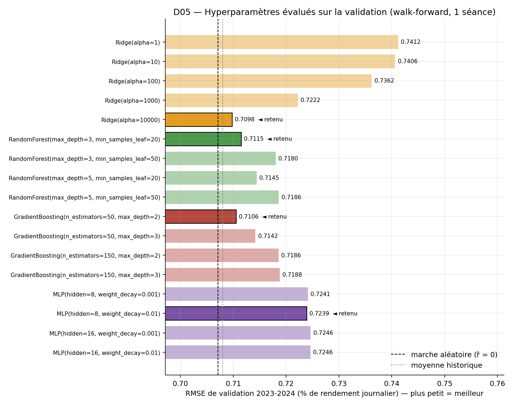
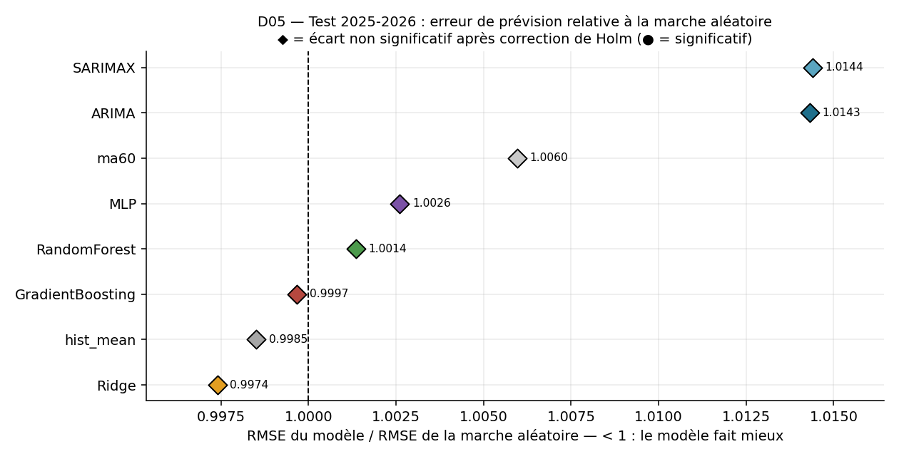
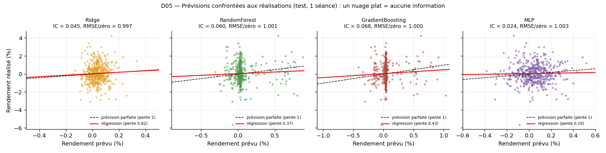
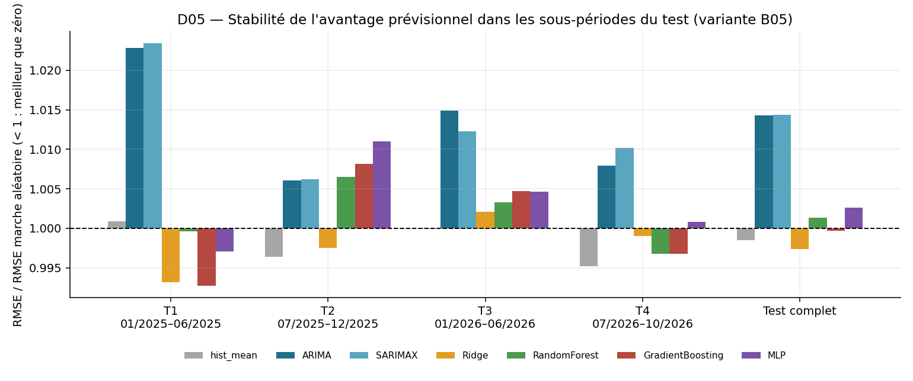
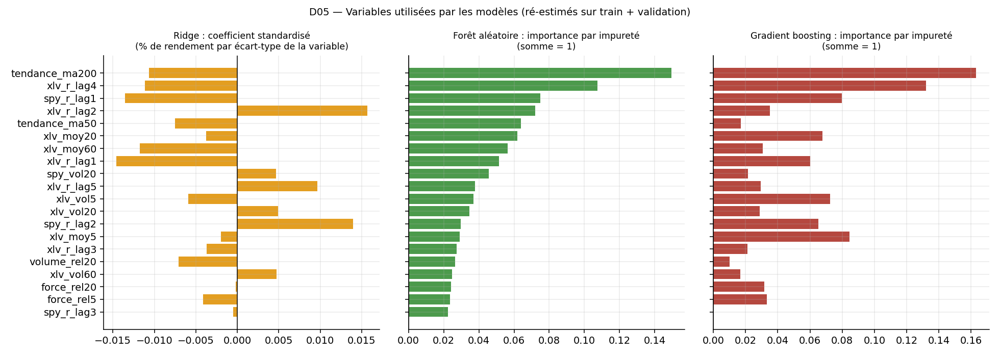

# D05 — Machine Learning et Deep Learning : prévision du rendement de XLV

> Fichier généré par `python -m src.ml_pipeline`. Ne pas modifier à la main : relancer la commande.

## 1. Cadre et protocole

- Snapshot figé : `data/snapshots/XLV_SPY_1d_20261116.csv` (SHA-256 `d80d6249f3dcebd0…`, vérifié au chargement). C'est le même que D02, D03 et D04 ; il est fixé dans `configs/ml.yaml`.
- **Cible** (identique à D03) : r_t = ln(P_t / P_{t-1}) sur prix ajusté, prévu à la clôture de t-1 (horizon : une séance). Les métriques sont exprimées en % de rendement journalier.
- **Information** : les 20 variables de la ligne t sont calculées avec les données jusqu'à la clôture de t-1 ; la normalisation (`StandardScaler`) est ajustée sur les seules données d'entraînement de chaque ré-estimation.
- **Échantillons** : train 2018-01-01 → 2022-12-31 (1259 séances) · validation 2023-01-01 → 2024-12-31 (502) · test 2025-01-01 → 2026-10-30 (459). L'année 2017 amorce seulement les moyennes glissantes ; elle n'est jamais utilisée pour estimer.
- **Walk-forward** : fenêtre croissante depuis le début du train, modèles ré-estimés toutes les 21 séances avec les seules lignes antérieures au bloc (même protocole que D03). Le test `test_walk_forward_no_lookahead` vérifie qu'aucune cible future n'influence une prévision passée.
- **Hyperparamètres** : grille limitée (`configs/ml.yaml`), évaluée **uniquement sur la validation** ; le choix est gelé dans `reports/d05_selection.json` **avant** la première prévision du test.
- **Comparaison** : mêmes données de test et mêmes coûts pour tous les modèles ; références = marche aléatoire (r̂ = 0), moyenne historique, moyenne mobile 60, et ARIMA(3,0,2) / SARIMAX de D03 ré-estimés ici sur le même snapshot. Graine globale : 20261125.
- Tests de Diebold-Mariano (correction de Harvey-Leybourne-Newbold) contre la marche aléatoire ; correction de **Holm** sur l'ensemble des 8 comparaisons du tableau 5 pour ne pas surestimer les gains en multipliant les modèles.

## 2. Variables explicatives

20 variables, toutes connues à la clôture de t-1 (aucune variable de la séance t) :

| variable | définition |
|---|---|
| xlv_r_lag1 … lag5 | rendements log de XLV des 5 séances précédentes (r_{t-1} … r_{t-5}) |
| xlv_moy5 / 20 / 60 | moyenne des rendements de XLV sur 5, 20 et 60 séances (jusqu'à t-1) |
| xlv_vol5 / 20 / 60 | écart-type des rendements de XLV sur 5, 20 et 60 séances (jusqu'à t-1) |
| spy_r_lag1 … lag3 | rendements log de SPY de t-1, t-2, t-3 |
| spy_vol20 | écart-type des rendements de SPY sur 20 séances (jusqu'à t-1) |
| force_rel5 / 20 | somme de (r^XLV − r^SPY) sur 5 et 20 séances (jusqu'à t-1) |
| tendance_ma50 / 200 | ln(prix ajusté de t-1 / moyenne mobile 50 ou 200 séances) |
| volume_rel20 | ln(volume de t-1 / volume moyen sur 20 séances) |

Le niveau de `adj_close` contient les dividendes futurs, mais tout rapport entre deux prix ajustés de dates passées (rendement, écart à une moyenne mobile) ne dépend que des dividendes situés entre ces dates : aucune fuite (voir `data/README.md`).

## 3. Hyperparamètres : sélection sur la validation

RMSE de validation (walk-forward, 2023-2024) de chaque candidat ; le candidat retenu par famille est celui de RMSE minimal.

| famille | candidat | RMSE_val_% | secondes_calcul | retenu | bord_de_grille |
|---|---|---|---|---|---|
| Ridge | Ridge(alpha=1) | 0.7412 | 0.0122 | False |  |
| Ridge | Ridge(alpha=10) | 0.7406 | 0.0118 | False |  |
| Ridge | Ridge(alpha=100) | 0.7362 | 0.0120 | False |  |
| Ridge | Ridge(alpha=1000) | 0.7222 | 0.0117 | False |  |
| Ridge | Ridge(alpha=10000) | 0.7098 | 0.0117 | True | alpha |
| RandomForest | RandomForest(max_depth=3, min_samples_leaf=20) | 0.7115 | 2.7544 | True |  |
| RandomForest | RandomForest(max_depth=3, min_samples_leaf=50) | 0.7180 | 2.5598 | False |  |
| RandomForest | RandomForest(max_depth=5, min_samples_leaf=20) | 0.7145 | 4.0579 | False |  |
| RandomForest | RandomForest(max_depth=5, min_samples_leaf=50) | 0.7186 | 3.4463 | False |  |
| GradientBoosting | GradientBoosting(n_estimators=50, max_depth=2) | 0.7106 | 2.6249 | True |  |
| GradientBoosting | GradientBoosting(n_estimators=50, max_depth=3) | 0.7142 | 3.7798 | False |  |
| GradientBoosting | GradientBoosting(n_estimators=150, max_depth=2) | 0.7186 | 7.8728 | False |  |
| GradientBoosting | GradientBoosting(n_estimators=150, max_depth=3) | 0.7188 | 11.3008 | False |  |
| MLP | MLP(hidden=8, weight_decay=0.001) | 0.7241 | 10.9192 | False |  |
| MLP | MLP(hidden=8, weight_decay=0.01) | 0.7239 | 10.4935 | True |  |
| MLP | MLP(hidden=16, weight_decay=0.001) | 0.7246 | 11.6942 | False |  |
| MLP | MLP(hidden=16, weight_decay=0.01) | 0.7246 | 11.7038 | False |  |

- Valeur retenue en **bord de grille** : Ridge (alpha). La grille n'a pas été élargie après coup : le faire reviendrait à chercher l'optimum sur la validation en réutilisant ses résultats. Un optimum en bord de grille signale surtout que le modèle préfère être le plus contraint possible, c'est-à-dire proche d'une constante.

Modèles retenus :

| famille | retenu | RMSE_val_% |
|---|---|---|
| Ridge | Ridge(alpha=10000) | 0.7098 |
| RandomForest | RandomForest(max_depth=3, min_samples_leaf=20) | 0.7115 |
| GradientBoosting | GradientBoosting(n_estimators=50, max_depth=2) | 0.7106 |
| MLP | MLP(hidden=8, weight_decay=0.01) | 0.7239 |

## 4. Résultats sur la validation (2023-2024)

Ces chiffres ont servi à choisir les hyperparamètres : ils sont **optimistes** pour les modèles ML/DL et ne prouvent rien. Seul le test (section 5) compte.

| modele | n | MAE_% | RMSE_% | DA | R2_oos | ratio_RMSE_zero | DM_p |
|---|---|---|---|---|---|---|---|
| zero | 502 | 0.5564 | 0.7071 | 0.5100 | 0.0025 | 1.0000 | — |
| hist_mean | 502 | 0.5569 | 0.7080 | 0.5100 | 0.0000 | 1.0013 | 0.6268 |
| ma60 | 502 | 0.5628 | 0.7130 | 0.4562 | -0.0143 | 1.0084 | 0.1617 |
| ARIMA | 502 | 0.5781 | 0.7278 | 0.4641 | -0.0566 | 1.0292 | 0.0034 |
| SARIMAX | 502 | 0.5785 | 0.7284 | 0.4622 | -0.0584 | 1.0301 | 0.0027 |
| Ridge | 502 | 0.5581 | 0.7098 | 0.4940 | -0.0050 | 1.0037 | 0.3605 |
| RandomForest | 502 | 0.5560 | 0.7115 | 0.5080 | -0.0099 | 1.0062 | 0.4052 |
| GradientBoosting | 502 | 0.5561 | 0.7106 | 0.5060 | -0.0072 | 1.0049 | 0.4467 |
| MLP | 502 | 0.5637 | 0.7239 | 0.5339 | -0.0454 | 1.0237 | 0.0214 |

## 5. Résultats sur le test (2025-2026)

DA = exactitude directionnelle ; R2_oos = 1 − SSE(modèle)/SSE(moyenne historique) ; ratio_RMSE_zero < 1 : le modèle fait mieux que la marche aléatoire ; DM_p = p-value brute du test de Diebold-Mariano contre la marche aléatoire ; p_Holm = p-value ajustée ; IC = corrélation prévision/réalisation ; pente_MZ = pente de la régression du réalisé sur le prévu (1 = prévision calibrée, 0 = sans information, < 0 = à contre-sens ; non interprétable quand la prévision est quasi constante, comme pour la moyenne historique) ; DA_PT_p = p-value brute du test de Pesaran-Timmermann sur l'exactitude directionnelle, DA_PT_Holm = p-value ajustée (— si la prévision est toujours de même signe).

| modele | n | MAE_% | RMSE_% | MAE_prix_USD | DA | R2_oos | ratio_RMSE_zero | DM_p | p_Holm | IC | pente_MZ | DA_PT_p | DA_PT_Holm |
|---|---|---|---|---|---|---|---|---|---|---|---|---|---|
| zero | 459 | 0.8077 | 1.0776 | 1.1858 | 0.5098 | -0.0030 | 1.0000 | — | — | — | — | — | — |
| hist_mean | 459 | 0.8082 | 1.0760 | 1.1869 | 0.5098 | 0.0000 | 0.9985 | 0.3399 | 1.0000 | -0.0584 | -22.4797 | — | — |
| ma60 | 459 | 0.8209 | 1.0840 | 1.2056 | 0.4989 | -0.0150 | 1.0060 | 0.2707 | 1.0000 | -0.0119 | -0.1052 | 0.8702 | 1.0000 |
| ARIMA | 459 | 0.8137 | 1.0930 | 1.1955 | 0.5142 | -0.0319 | 1.0143 | 0.1761 | 1.0000 | 0.0164 | 0.0836 | 0.5809 | 1.0000 |
| SARIMAX | 459 | 0.8141 | 1.0931 | 1.1961 | 0.5076 | -0.0321 | 1.0144 | 0.1730 | 1.0000 | 0.0161 | 0.0819 | 0.7921 | 1.0000 |
| Ridge | 459 | 0.8038 | 1.0748 | 1.1811 | 0.5577 | 0.0022 | 0.9974 | 0.4817 | 1.0000 | 0.0450 | 0.8239 | 0.0090 | 0.0633 |
| RandomForest | 459 | 0.8055 | 1.0791 | 1.1832 | 0.5185 | -0.0057 | 1.0014 | 0.8952 | 1.0000 | 0.0602 | 0.3688 | 0.4994 | 1.0000 |
| GradientBoosting | 459 | 0.8050 | 1.0773 | 1.1827 | 0.5229 | -0.0023 | 0.9997 | 0.9756 | 1.0000 | 0.0683 | 0.4331 | 0.3511 | 1.0000 |
| MLP | 459 | 0.8099 | 1.0804 | 1.1897 | 0.5272 | -0.0082 | 1.0026 | 0.6801 | 1.0000 | 0.0236 | 0.1941 | 0.2752 | 1.0000 |

Comparaison à la moyenne historique (Diebold-Mariano, p-value brute) :

| modele | DM_vs_moyenne | DM_moyenne_p |
|---|---|---|
| zero | 0.9553 | 0.3399 |
| ma60 | 1.4468 | 0.1486 |
| ARIMA | 1.5455 | 0.1229 |
| SARIMAX | 1.5567 | 0.1202 |
| Ridge | -0.3480 | 0.7280 |
| RandomForest | 0.2869 | 0.7743 |
| GradientBoosting | 0.1108 | 0.9118 |
| MLP | 0.6665 | 0.5055 |

### Prévisions confrontées aux réalisations

## 6. Stabilité dans les sous-périodes du test (variante B05)

Ratio RMSE(modèle) / RMSE(marche aléatoire) dans chaque sous-période du test, comme en D03. Une valeur < 1 indique un avantage dans la période.

| modele | T1 | T2 | T3 | T4 |
|---|---|---|---|---|
| ARIMA | 1.023 | 1.006 | 1.015 | 1.008 |
| GradientBoosting | 0.993 | 1.008 | 1.005 | 0.997 |
| MLP | 0.997 | 1.011 | 1.005 | 1.001 |
| RandomForest | 1.000 | 1.007 | 1.003 | 0.997 |
| Ridge | 0.993 | 0.997 | 1.002 | 0.999 |
| SARIMAX | 1.023 | 1.006 | 1.012 | 1.010 |
| hist_mean | 1.001 | 0.996 | 1.000 | 0.995 |
| ma60 | 1.015 | 0.999 | 1.010 | 0.993 |

## 7. Parcimonie et coût de calcul

Paramètres : coefficients (Ridge), nœuds d'arbres (forêt, boosting), poids d'un réseau (MLP, dont le modèle final moyenne 3 réseaux), AR + MA + constante + variance (+ coefficient SPY) pour D03. Secondes : temps cumulé d'estimation pendant le walk-forward du test (CPU). La marche aléatoire n'a aucun paramètre.

| modele | candidat | parametres | refits | secondes_test | ms_par_refit |
|---|---|---|---|---|---|
| Ridge | Ridge(alpha=10000) | 21 | 22 | 0.0 | 0.5 |
| RandomForest | RandomForest(max_depth=3, min_samples_leaf=20) | 1492 | 22 | 3.3 | 148.8 |
| GradientBoosting | GradientBoosting(n_estimators=50, max_depth=2) | 256 | 22 | 3.2 | 146.7 |
| MLP | MLP(hidden=8, weight_decay=0.01) | 177 | 22 | 12.7 | 575.9 |
| ARIMA | ARIMA(3,0,2) | 7 | 22 | — | — |
| SARIMAX | SARIMAX(3,0,2) + r_SPY(t-1) | 8 | 22 | — | — |

### Variables utilisées

Ridge : coefficients standardisés ; arbres : importance par impureté (biaisée en faveur des variables continues très variables, à lire comme une indication). Modèles ré-estimés sur train + validation, sans le test.

## 8. Conclusions

1. **Prévision du rendement (test), au sens de l'erreur quadratique.** Aucun des 4 modèles ML/DL ne bat significativement la marche aléatoire (p ajustée de Holm ≥ 5.0 % pour tous). Meilleur modèle ML/DL : **Ridge** (RMSE 1.0748 %, soit 0.997 fois celui de la marche aléatoire ; p ajustée 1.00). 2 modèle(s) sur 4 ont un RMSE inférieur à 1 fois celui de la marche aléatoire (Ridge, GradientBoosting), mais l'écart n'est pas distinguable du hasard d'échantillonnage.
2. **Face aux références simples et à D03.** Meilleure référence simple : hist_mean (RMSE 1.0760 %). Meilleur modèle de D03 : ARIMA (1.0930 %). Écart entre le meilleur ML/DL et la meilleure référence simple : +0.1 point(s) de base par séance sur le RMSE (un point de base = 0,01 % de rendement), en faveur du ML/DL. La **significativité économique** est donc faible : elle ne sera établie ou infirmée que par le backtest net de coûts (D06).
3. **Direction.** L'exactitude directionnelle des modèles ML/DL va de 51.9 % à 55.8 % (la référence « toujours hausse » obtient 51.0 %). Les corrélations prévision/réalisation (IC) vont de +0.024 à +0.068 (aucune significative à 5 %). Test de Pesaran-Timmermann (l'exactitude diffère-t-elle du hasard ?) : **Ridge dépasse(nt) le hasard à 5 % en p brute** (Ridge : exactitude 55.8 % en test contre 49.4 % en validation, p brute 0.009, p ajustée de Holm 0.063). Il ne l'est plus après correction de Holm sur l'ensemble des modèles du tableau. C'est le **seul indice favorable** de ce livrable : il n'est accompagné d'aucun gain de RMSE, il est apparu après avoir examiné plusieurs modèles et plusieurs métriques (un p voisin de 0,01 peut survenir par hasard), et il n'existait pas en validation. Il doit être traité comme une hypothèse à confirmer (backtest net de coûts en D06, nouvelles séances en D08), pas comme une preuve.
4. **Validation et test.** Aucun modèle ML/DL ne bat la marche aléatoire en RMSE sur la validation ; le test confirme l'absence d'avantage.
5. **Stabilité (variante B05).** Nombre de sous-périodes T1–T4 où le RMSE est inférieur à celui de la marche aléatoire : Ridge 3/4, RandomForest 2/4, GradientBoosting 2/4, MLP 1/4. Un avantage présent dans toutes les sous-périodes serait un indice de robustesse ; ici aucun modèle ne l'obtient.
6. **Parcimonie.** Les modèles ML/DL comptent de 21 à 1492 paramètres (coefficients, nœuds d'arbres ou poids) contre 7 pour l'ARIMA de D03 et 0 pour la marche aléatoire, et exigent de 0.0 à 13 s de calcul pour le seul test (la marche aléatoire n'en exige aucun). Comme aucun gain significatif n'est observé, cette complexité n'est **pas justifiée** sur cet échantillon.
7. **Réponse à la question B05.** Sur ce secteur défensif, les modèles complexes (ML et réseau de neurones) n'apportent pas de gain d'erreur de prévision (RMSE) significatif face à des références simples, avec une réserve sur la direction du rendement (conclusion 3). Ce résultat est cohérent avec D03 (ARIMA) : le rendement quotidien de XLV est très proche d'un bruit à moyenne quasi constante, et l'information supplémentaire contenue dans 20 variables ne suffit pas à le prévoir hors échantillon. Les modèles de risque de D04, eux, ont un rôle plus net.
8. Les prévisions datées de chaque modèle (validation et test) sont dans `reports/d05_predictions.csv`. Elles alimenteront la règle de décision de D06 et l'espace Model Laboratory de l'application (D07).

## 9. Limites

- Une seule série (XLV), une seule fréquence (journalière) et un horizon d'une séance ; 459 séances de test seulement : seuls des écarts de RMSE assez grands sont détectables.
- Les gains de RMSE sur un rendement quotidien sont minuscules par nature (le rendement est dominé par le bruit) ; l'absence de significativité n'est pas la preuve qu'aucun signal n'existe, seulement qu'on n'en détecte pas ici.
- Grilles d'hyperparamètres volontairement petites (cahier : recherche limitée à la validation) ; un réseau plus grand, un LSTM ou un TCN (facultatifs) n'ont pas été explorés.
- Le RMSE mesure la qualité de la prévision, pas la rentabilité : la valeur économique d'une prévision légèrement meilleure se juge en D06, avec frais, glissement et turnover.
- Les temps de calcul dépendent de la machine ; seuls leurs ordres de grandeur sont comparables.

_Logiciels : scikit-learn, PyTorch, statsmodels, scipy. Durée d'exécution : 118 s._
